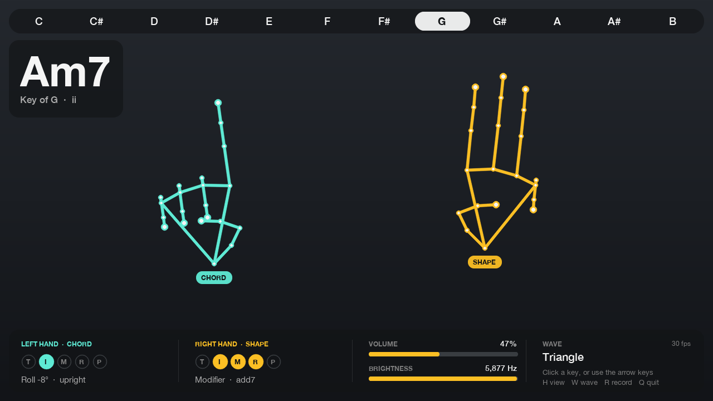

# Hand Synth

A webcam instrument. Hold your hands up to the camera: the **left hand picks the chord**, the
**right hand shapes it**. Chords stay in the chosen key, switch without clicks, and sit low enough
to sing over.



<sub>Overlay rendered with synthetic hands (left: index → ii; right: three fingers → add7). Regenerate with `python scripts/render_screenshot.py`.</sub>

## Quick start (macOS, Apple Silicon)

```bash
uv venv -p 3.12 .venv            # or: python3.12 -m venv .venv
uv pip install -p .venv/bin/python -e ".[dev]"     # or: .venv/bin/pip install -e ".[dev]"
.venv/bin/python -m hand_synth.main
```

- Use Python **3.11 or 3.12**. `mediapipe` is pinned to `0.10.21`, because 1.0.x crashes on macOS in its
  Metal helper even with the CPU delegate.
- The hand model (`models/hand_landmarker.task`, ~7.5 MB) downloads automatically on first run.
- **Run it from Terminal the first time.** macOS asks for camera permission for the app that
  launched Python. If you get `cannot read from camera`, allow it in System Settings → Privacy &
  Security → Camera, then rerun. The app keeps retrying for `CAMERA_WAIT_S` (15 s), so you can click
  Allow on the first-run prompt without restarting.
- Sound only, no camera: `.venv/bin/python -m hand_synth.demo_keys` (the key bar is clickable there too). Keys `1`–`7` pick a degree, `0` is silence,
  `m` flips major/minor, `s` cycles sus2/sus4, `j`/`k`/`l` toggle add7/add9/add6, `←`/`→` change key,
  `↑`/`↓` change gain, `[`/`]` change cutoff, `w` changes the waveform.

Options:
- `--key G` sets the startup key.
- `--ui minimal` sets the starting overlay mode.
- `--camera 1` picks another camera, and `--camera clip.mp4` plays a recorded video instead.

Sound goes to the macOS output and follows it. If you switch outputs while playing (AirPods connect,
or you pick another speaker in Control Center), the chord fades over to the new device within about
half a second. To always use one device, set `AUDIO_DEVICE` in `hand_synth/config.py`.

## Opening it

Run this once from the repo:

```bash
scripts/install_launchers.sh
```

It sets up `.venv` if needed and installs two launchers that point at this checkout:

- **Hand Synth.app** in `~/Applications`. Open it from Spotlight (⌘-Space, "Hand Synth"), Launchpad or the Dock.
  The first time, macOS asks whether *Hand Synth* may use the camera. Output goes to `~/Library/Logs/HandSynth.log`.
- **`hand-synth`**, a command that works from any terminal: `hand-synth --key G --ui minimal`.

Re-run the script if you move the repo.

## How to play

| Hand | Gesture | Effect |
|---|---|---|
| **Left** (chords) | open hand | I (tonic) |
| | index | ii |
| | index + middle | iii |
| | index + middle + ring | IV |
| | four fingers (no thumb) | V |
| | thumb | vi |
| | thumb + index | vii° |
| | fist | silence (fades out) |
| | roll the hand > ~45° (back < ~25°) | flip major ↔ minor (dim → minor) |
| **Right** (expression) | open | plain chord |
| | index | sus2 |
| | index + middle | sus4 |
| | index + middle + ring | add7 |
| | four fingers | add9 |
| | thumb | add6 |
| | thumb + index ("L") | 7: flat 7th (D7 in the key of D; add7 gives the in-key Dmaj7) |
| | raise / lower the hand | louder / quieter: full volume with the wrist at mid-screen, fading to silent near the bottom (a dB fader, ≈ 9 dB per 10% of screen height) |
| | open / close the thumb–index pinch | brighter / darker |
| | move the hand outward / inward | more / less reverb ("space") |

Click a key along the top bar to change the key; `←`/`→` do the same.

**Sliders.** The bottom panel's VOLUME, BRIGHTNESS and SPACE are sliders. Drag one to set a level, and its
chip changes from HAND to **SLIDER**: the level stays where you set it however your hand moves. Click the
SLIDER chip to give that control back to your hand. Click Sine / Triangle / Saw to change the waveform.

  Set the startup mode with `UI_MODE` in config or `--ui`.
- `w` cycles the waveform (sine / triangle / saw).
- `r` records the current landmarks as a test fixture.
- `q` or `Esc` quits, with a fade-out.

Other behaviour:
- **Unknown gestures** keep the current chord, so moving between two shapes never dips to silence.
- **Losing the left hand** keeps the chord sounding; make a fist to stop it.
- **When the right hand leaves**, the modification resets to none, but volume and brightness hold.
- **Which hand is which comes from where it is on screen**, not from MediaPipe's left/right
  classifier, whose labels depend on mirroring and hand orientation. With two hands, the one on
  the screen's left plays chords. A single hand counts as Left or Right by which half of the frame
  it's in, with a small dead band at the centre. `HANDEDNESS = "mediapipe"` switches back to the classifier.
- **Every gesture mapping lives in [`hand_synth/config.py`](hand_synth/config.py)** (`FINGER_MAP`, `MOD_MAP`), along with every other tunable. To redesign the instrument, edit that file.

## Fixtures

The fixtures live under `fixtures/landmarks/`, one JSON file per hand:
`{"label", "landmarks": [[x,y,z]×21], "score", "source", "expected": {"fingers", "roll_deg"}}`.

| Folder | Contents |
|---|---|
| `synthetic/` | Generated hands: all 32 finger states × both hands × roll/scale/noise variations, plus roll poses. Regenerate with `python scripts/make_synthetic_fixtures.py`. |
| `real/` | Landmarks from MediaPipe's public test photos (some rotated or upside down), with fingers checked by eye. |
| `recorded/` | What `r` saves from your own camera. The filename and `expected.fingers` come from `fingers_up()`'s reading at that moment, so **check each one and rename it if it misread your hand.** |

Recording ~15 poses per hand plus a few rolled poses is the best test of `fingers_up()`. It's also the starting dataset for the later classifier (`gesture.ClassifierSource`).

## Sound

The synth turns the chord into a warm pad you can sing over. All of it runs in numpy with no
extra audio stack, taking about 0.1 ms of CPU per 5.8 ms audio block.

- **Balanced voicing** (`VOICING_STYLE = "balanced"`). The root sits alone in the bass, and the other notes
  stack above it the way an arranger would:
  - **Spacing:** wide intervals low and close intervals high, like the overtone series.
  - **No clashes:** no minor 2nds or minor 9ths anywhere. For example, a maj7 never doubles the root a half step above the 7th.
  - **Low interval limits:** intervals that turn muddy low down are kept above their limits; a major 2nd, for example, stays above E♭3.
  - **Added notes go on top:** the triad (root, 3rd, 5th) is the chord, and the added notes (7th, 9th, 6th) stack above it.
    Cmaj7 is C2 · E3 G3 B3, and C6 is C2 · G3 E4 A4.
  - **5th dropped only when needed:** the 5th, the least characteristic note, is dropped only when that makes the chord more balanced.
  - **Voice leading:** each new chord is chosen to move as little as possible from the last, holding common tones. In C, the progression C → F → G → Am goes
    C2 G3 C4 E4 → F2 A3 C4 F4 → G2 G3 B3 D4 → A2 A3 C4 E4.
  - **Measured result:** across all 1,008 key × degree × flip × modifier combinations, a psychoacoustic roughness model
    (Plomp–Levelt) rates these voicings 54% smoother on average than a plain close voicing, and none rougher.
    `"close"` keeps the old tight voice-led cluster.
- **Unison.** Each note is a centre oscillator plus a pair detuned by ±`DETUNE_CENTS`, for a slow chorus shimmer. The centre keeps the fundamental steady, so the bass never beats out.
- **Space (reverb).** A stereo Freeverb room with about 2.5 s of tail (`REVERB_ROOM`) and a 25 ms pre-delay. The left
  and right ears get differently tuned delays, which is what makes it sound like a room and not a smear. It runs
  from dry (0%) to a wash (100%) at roughly constant loudness, so space never acts as a volume knob. Move
  the right hand outward for more, or drag the SPACE slider.
- **Stereo.** The detuned unison pair leans left and right (`UNISON_SPREAD`), so the pad itself is wide.
- **Click-free.** Every chord change is a crossfade between per-voice envelopes. Gain, cutoff, reverb and
  waveform changes are all ramped. The offline tests check each of these for clicks.

## Coordinates

`tracking.py` returns aspect-corrected landmarks:
- `y` is MediaPipe's normalized y (0 at the top, 1 at the bottom).
- `x` and `z` are multiplied by width/height, so `x` runs 0..1.78 on a 16:9 camera.

This makes angles and distances real: a hand rolled 45° reads as 45°. On raw normalized
coordinates a 16:9 frame squashes that to ~29°, and the 35° flip threshold would need ~60° of wrist rotation.

## Layout

```
hand_synth/
  config.py        all tunables (data only)
  main.py          camera loop; Instrument = per-frame mapping (testable)
  tracking.py      MediaPipe HandLandmarker wrapper -> HandsFrame
  fingers.py       fingers_up(): which fingers are extended
  features.py      hand size, wrist, pinch, roll, feature vector
  stabilize.py     Hold, RollZone, EMA
  gesture.py       finger tuple -> degree; ClassifierSource seam
  music.py         key/scale/chord math -> MIDI, Hz, names
  synth/base.py    Synth interface (start/stop/set_chord/set_params)
  synth/numpy_synth.py  sounddevice backend
  ui.py            overlay + clickable key bar
  demo_keys.py     keyboard-only synth demo
tests/             pytest; no camera or speakers needed
```

To swap the audio backend (pyo, SuperCollider), implement the four methods in `synth/base.py` and
change the one `NumpySynth(cfg)` line in `main.py`.

## Tests

```bash
.venv/bin/python -m pytest -q
```

The suite covers:
- music theory for all 12 keys × 7 degrees × mods and flips;
- the stabilizers;
- offline synth rendering, asserting no clicks on chord, waveform and gain changes and true silence after release;
- `fingers_up()` and `features.py` against every fixture;
- the acceptance checklist below, run as `tests/test_instrument.py` on synthetic hands.

## Acceptance checklist (live)

- [ ] Hold up only your **right** hand, on the right of the screen: the overlay labels it `Right` and tags it SHAPE.
- [ ] Select key **G**. Left open hand plays G; left index alone plays Am.
- [ ] Roll the left hand ~45° to get A (flipped); back upright gives Am.
- [ ] Right index + middle gives Asus4; right index + middle + ring gives Am7.
- [ ] Closing the right pinch darkens the sound; lowering the right hand makes it quieter.
- [ ] A left fist gives silence, with a fade.
- [ ] Click **D**: an open hand now plays D major.
- [ ] Hold a chord and sing over it for 30 seconds without hearing a click.

## Troubleshooting

| Symptom | Fix |
|---|---|
| `cannot read from camera` | Grant camera permission to your terminal app (see Quick start), or try `--camera 1`. |
| `Audio output failed` | The message lists your devices. Set `AUDIO_DEVICE` in config to one of them. |
| Red **XRUN** badge | The audio buffer is underrunning. Raise `BLOCK_SIZE` to 512. |
| App exits or misbehaves right after "camera ..." | Check `models/mediapipe.log`. MediaPipe's own startup messages go there instead of cluttering the terminal. |
| Chords flicker | Raise `HOLD_FRAMES`. If they feel sluggish, lower it. |
| Hands get the wrong roles | Keep each hand on its own side of the screen. A lone hand switches role when it crosses the centre line. To swap which side plays chords, swap `CHORD_HAND` / `EXPR_HAND`. |
| Major/minor flips too easily or not at all | Tune `ROLL_MINOR_DEG` and `ROLL_DEADBAND_DEG`. The HUD shows the live roll angle. |
| Volume range feels off | Tune `WRIST_Y_QUIET` / `WRIST_Y_LOUD`, the wrist heights for silent and full. |
| Too much / too little reverb | Tune `REVERB_MIX_RANGE` (and `WRIST_X_DRY` / `WRIST_X_WET`), or `REVERB_ROOM` for a longer or shorter tail. |
| Chords sound muddy on laptop speakers | Set `BASS_NOTE = False`, or raise `ROOT_OCTAVE` / `VOICING_RANGE`. |
